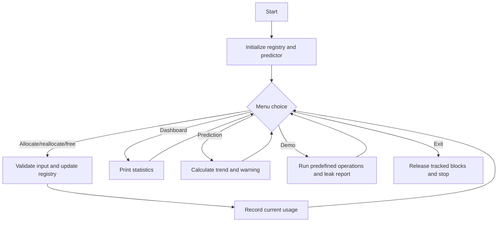

# MemPredictC

**Predict Memory. Detect Leaks. Optimize C Applications.**

MemPredictC is an educational C11 program that wraps its own `malloc`, `calloc`,
`realloc`, and `free` calls. It tracks those allocations, reports unreleased
blocks, and estimates near-future usage from recent observations. It does not
monitor arbitrary processes or all operating-system memory.

## Objectives and features

- Make dynamic memory behavior visible to a beginner.
- Demonstrate the four core dynamic-memory operations.
- Track total allocated, total freed, current, peak, and active memory.
- Assign IDs to active allocations and report outstanding blocks at exit.
- Estimate future usage using the average upward change in recent observations.
- Warn when a projection reaches the configurable 1024-byte threshold.
- Provide a dashboard, input validation, and a two-minute automatic demonstration.

## Problem statement

Long-running C applications can keep dynamically allocated memory after it is
no longer needed. This increases memory usage and can eventually affect
reliability. Beginners also find it difficult to see how individual
allocations change total usage.

## Proposed solution

MemPredictC gives every allocation made through its wrapper functions a unique
ID. It updates counters after each operation, displays current and peak usage,
and lists active IDs in a leak report. A small trend calculator uses recent
observations to estimate memory required for future operations.

## Team and technology

This is a First-Year BTech Mini Hackathon project for **Batch 10, Team 12**.
The implementation uses standard C11 and the C standard library. Team member
names and SAP IDs are intentionally not invented; add verified names before
submission.

## Architecture

`main.c` owns the menu, input validation, and demonstration. `memory.c` owns a
fixed registry of up to 256 active allocations and aggregate statistics.
`predictor.c` stores the latest 64 observations and calculates a simple
average upward trend. See [docs/ARCHITECTURE.md](docs/ARCHITECTURE.md).

## C concepts demonstrated

- Function decomposition across `.c` and `.h` modules.
- Structures, enumerations, arrays, pointers, and `void *`.
- `malloc`, `calloc`, `realloc`, and `free`.
- Input parsing with `fgets`, `strtoull`, and validation.
- `size_t`, overflow guards, loops, and conditional logic.

## Menu

| Option | Action |
|---:|---|
| 1 | Allocate with `malloc` |
| 2 | Allocate with `calloc` |
| 3 | Resize an active allocation |
| 4 | Free an active allocation |
| 5 | View the memory dashboard |
| 6 | Predict future usage |
| 7 | Run the automatic demonstration |
| 8 | Check tracked leaks |
| 9 | Release tracked blocks and exit |

## Build and run

With GCC or Clang:

```text
make
./mempredictc
```

On Windows, run `mempredictc.exe` after building, or compile directly:

```text
gcc -std=c11 -Wall -Wextra -Wpedantic -O2 main.c memory.c predictor.c -o mempredictc.exe
```

Choose option 7 for the guided demonstration. Option 9 releases any remaining
tracked blocks before exiting.

### Windows dashboard

The Windows build uses the native Win32 API, so raylib and third-party runtime
DLLs are not required. With MinGW GCC on `PATH`, run:

```text
build.bat
run.bat
```

`build.bat` also detects the standard `C:\MinGW\bin\gcc.exe` installation when
GCC is not already on `PATH`. It produces `build\MemPredictC.exe` and
`build\MemPredictC_CLI.exe`, and copies both to `release\`.

The dashboard is written in [ui.c](ui.c) and uses read-only snapshots from the
memory and predictor modules. It provides live statistics, a trend graph,
allocation controls, leak status, prediction output, an activity log, resize
support, and exit cleanup. `build\MemPredictC.exe` is the GUI output and
`build\MemPredictC_CLI.exe` is the CLI output. If GUI initialization fails,
the Windows launcher invokes the CLI.

## Algorithm and pseudocode

For observations `u[0] ... u[n-1]`, the predictor adds only non-negative
successive changes, then computes:

```text
average_change = sum(max(0, u[i] - u[i-1])) / (n - 1)
projection = u[n-1] + average_change * requested_steps
```

This is a transparent trend estimate, not machine learning. It cannot predict
untracked allocations, sudden workload changes, or operating-system pressure.

```text
start
initialize allocation registry and observation history
repeat
    display menu and validate choice
    perform requested allocation operation
    if operation succeeds, record current bytes
    if prediction requested:
        require at least two observations
        calculate average upward change
        project requested number of operations
        compare projection with warning threshold
until exit
release all remaining tracked blocks
stop
```

## Flowchart



## Testing

The test strategy and genuine command results are maintained in
[docs/TESTING.md](docs/TESTING.md). Manual cases are listed in
[tests/test_cases.md](tests/test_cases.md), with a repeatable input script in
[tests/sample_inputs.txt](tests/sample_inputs.txt).

Representative test cases include:

1. Allocate 64 bytes with `malloc` and confirm dashboard counters.
2. Allocate with `calloc`, then free the returned ID.
3. Reallocate an active block to a larger and then smaller size.
4. Enter zero, text, or an unknown ID and confirm a safe error message.
5. Run option 7 and confirm the intentional outstanding allocation appears.

The local MinGW GCC installation was found but exited before producing an
executable during validation. Therefore no runtime output is claimed here;
see [docs/TESTING.md](docs/TESTING.md) for the exact status.

## Limitations and future improvements

The fixed registry is intentionally small and educational. The tool cannot
intercept raw allocation calls in another program, identify every dangling
pointer or buffer error, or replace a production profiler. Future work could
add configurable registry capacity, CSV export, platform-specific integration,
and richer visualizations.

## Conclusion

MemPredictC is a small, explainable demonstration of responsible dynamic
memory management in C. It helps students connect allocation operations with
live statistics, tracked leaks, and a simple future-usage estimate while being
clear about the limits of the approach.

## Documentation

Project context, design, decisions, flow, handover status, and presentation
material are in [docs/](docs/). Reusable AI prompts are in [prompts/](prompts/).
The formal project report is available at
[docs/PROJECT_REPORT.md](docs/PROJECT_REPORT.md).
