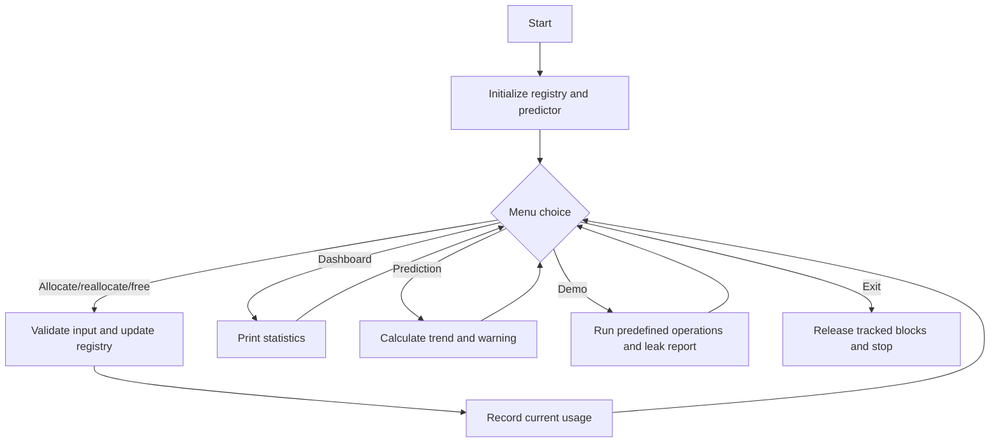

# MemPredictC

**Predict Memory. Detect Leaks. Optimize C Applications.**

MemPredictC is an educational C11 program that wraps its own `malloc`, `calloc`,
`realloc`, and `free` calls. It tracks those allocations, reports unreleased
blocks, and estimates near-future usage from recent observations. It does not
monitor arbitrary processes or all operating-system memory.

## Objectives and features

- Demonstrate the four core dynamic-memory operations.
- Track total allocated, total freed, current, peak, and active memory.
- Assign IDs to active allocations and report outstanding blocks at exit.
- Estimate future usage using the average upward change in recent observations.
- Warn when a projection reaches the configurable 1024-byte threshold.
- Provide a dashboard, input validation, and a two-minute automatic demonstration.

## Team and technology

This is a First-Year BTech Mini Hackathon project for **Batch 10, Team 12**.
The implementation uses standard C11 and the C standard library. Team member
names and SAP IDs are intentionally not invented; add verified names before
submission.

## Architecture

`main.c` owns the menu, input validation, and demonstration. `memory.c` owns a
fixed registry of up to 256 active allocations and aggregate statistics.
`predictor.c` stores the latest 64 observations and calculates a simple
average upward trend. See [docs/ARCHITECTURE.md](docs/ARCHITECTURE.md).

## Build and run

With GCC or Clang:

```text
make
./mempredictc
```

On Windows, run `mempredictc.exe` after building, or compile directly:

```text
gcc -std=c11 -Wall -Wextra -Wpedantic -O2 main.c memory.c predictor.c -o mempredictc.exe
```

Choose option 7 for the guided demonstration. Option 9 releases any remaining
tracked blocks before exiting.

## Algorithm and pseudocode

For observations `u[0] ... u[n-1]`, the predictor adds only non-negative
successive changes, then computes:

```text
average_change = sum(max(0, u[i] - u[i-1])) / (n - 1)
projection = u[n-1] + average_change * requested_steps
```

This is a transparent trend estimate, not machine learning. It cannot predict
untracked allocations, sudden workload changes, or operating-system pressure.

## Flowchart



## Testing

The test strategy and genuine command results are maintained in
[docs/TESTING.md](docs/TESTING.md). Manual cases are listed in
[tests/test_cases.md](tests/test_cases.md), with a repeatable input script in
[tests/sample_inputs.txt](tests/sample_inputs.txt).

## Limitations and future improvements

The fixed registry is intentionally small and educational. The tool cannot
intercept raw allocation calls in another program, identify every dangling
pointer or buffer error, or replace a production profiler. Future work could
add configurable registry capacity, CSV export, platform-specific integration,
and richer visualizations.

## Documentation

Project context, design, decisions, flow, handover status, and presentation
material are in [docs/](docs/). Reusable AI prompts are in [prompts/](prompts/).
