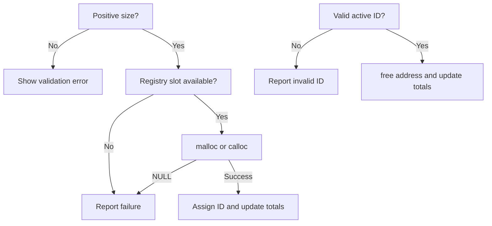
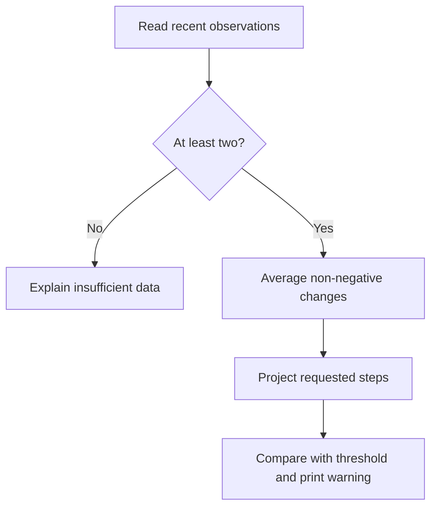

# Program Flow

1. `main` initializes the registry and predictor, then records an initial zero
   observation.
2. The menu reads a whole-number choice with `fgets` and `strtoull`.
3. Allocation and reallocation validate positive sizes, call the memory module,
   and record current usage after success.
4. Free validates an ID and marks the matching registry entry inactive.
5. Prediction requires at least two observations, calculates average upward
   change, and compares the projection with the threshold.
6. The demo performs malloc, calloc, realloc, free, a deliberate unreleased
   allocation, prediction, dashboard, and leak reporting.
7. Exit releases any remaining tracked addresses before returning.

The Windows launcher initializes the same modules through `ui.c`. If window
creation fails, `gui_main.c` calls the existing `cli_run` entry point instead.
The dashboard records observations after successful operations and renders
bounded snapshots; it never accesses the registry's static storage directly.

## Allocation and deallocation

## Prediction

